<div align="center">

# 光阑视界 IrisVision

**产线双相机视觉检测上位机：汇川 PLC 三拍握手指挥"扫码、几号点位拍"，
它派两台基恩士相机切程序开拍，每张图一个 OK/NG 徽标落进大屏窗口矩阵，
判定立刻写回 PLC 放行，图片按 SN 全量归档。**


软件中文名**光阑视界**、英文名 **IrisVision**（V2.16.9 起工程名 / exe 文件名 /
命名空间统一为 IrisVision；此前叫 CommandCenter，项目未上线不兼容旧名）。
Windows 桌面程序，第三方 DLL 随仓库 `libs/` 拷贝——**离线可编译，不依赖 NuGet**。

</div>

---

## 你是谁，看哪份手册

| 你是谁 | 看哪份 |
| --- | --- |
| 现场操作员（第一次摸软件） | `docs/光阑视界操作员手册.md`：开机、看图、报警处置、点检禁忌 |
| 客户技术员/工艺工程师 | `docs/光阑视界客户技术手册.md`：换型、点位配置、MES 联调、排障 |
| 我方现场工程师 | `docs/光阑视界内部手册.md`：账号全流程、技术实现篇、交付清单 |

## 界面速览

没开工时主界面是 21 格深灰空窗口（U171 默认自适应铺排 3×7），标题栏型号/序列号/计数/状态灯一排，
底部"等待 PLC 请求"即待机正常。PLC 一发拍照请求，窗口逐格出图、右下角徽标变色：

| 空闲待机（21 格深灰） | 全 OK 件（演示数据） |
| --- | --- |
| 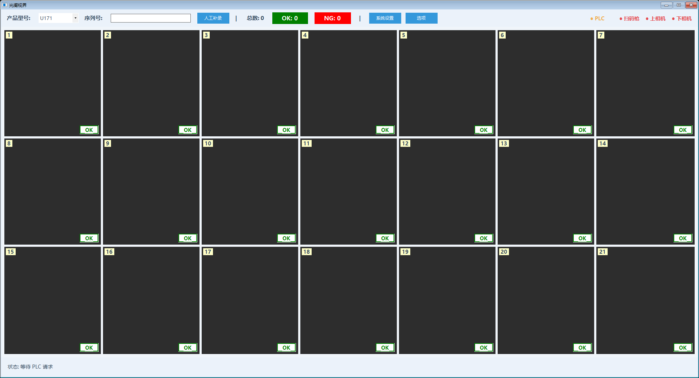 | 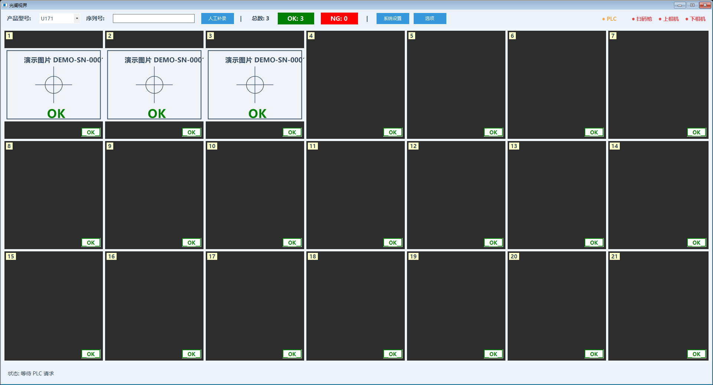 |
| **混有 NG 件（总数 5、OK 3、NG 2）** | **系统设置（管理员登录后）** |
| 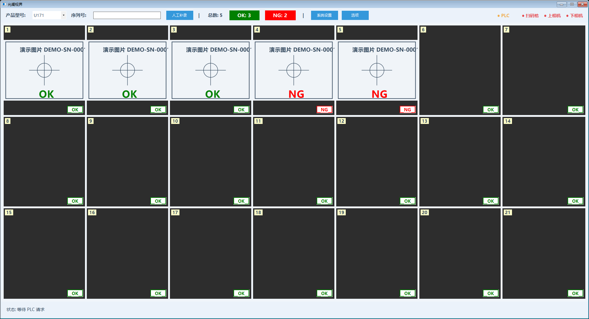 | 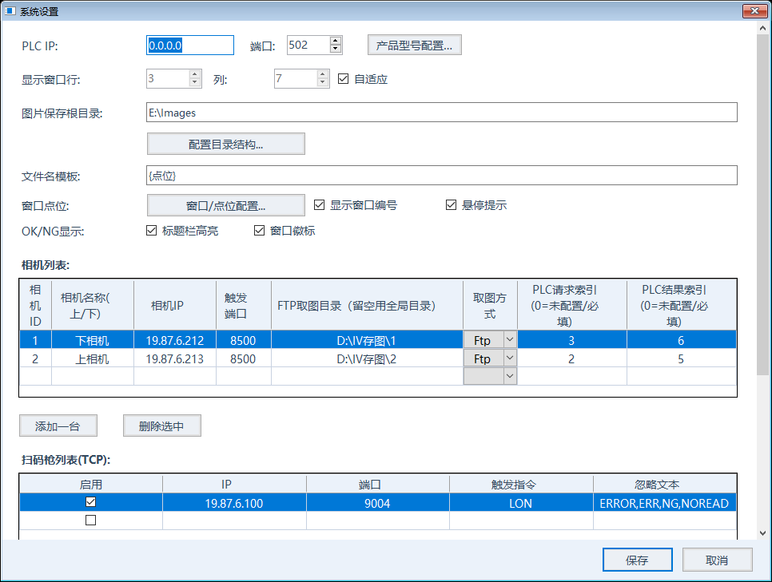 |
| **窗口↔点位 + 点位→程序 配置** | **存图目录结构配置** |
| 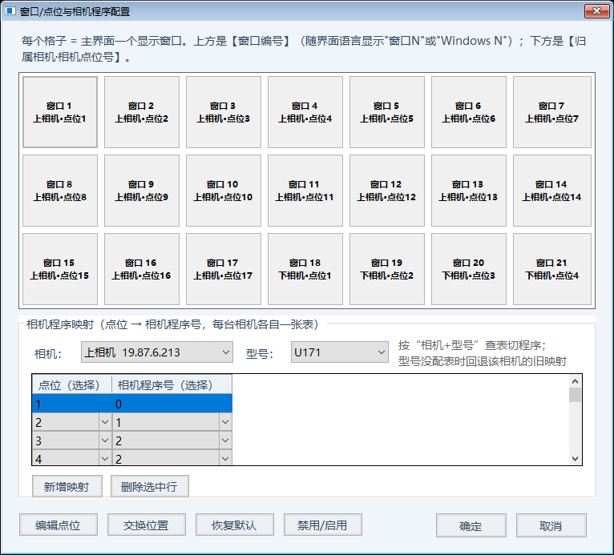 | 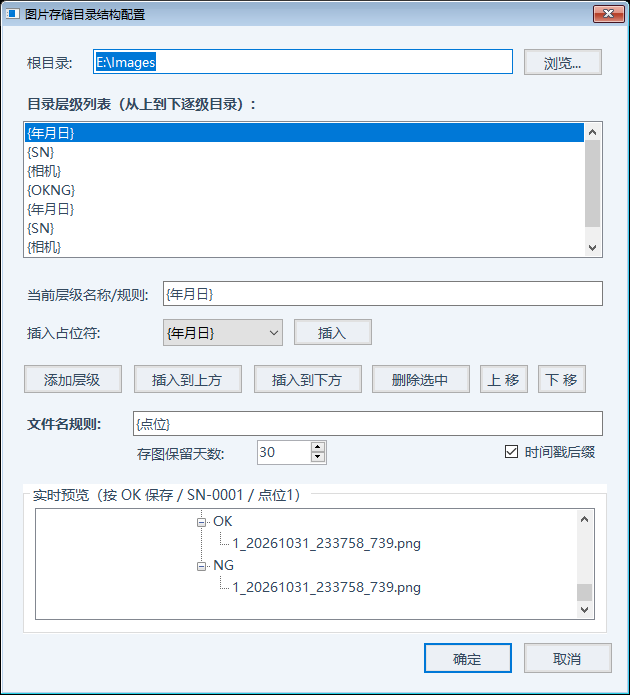 |
| **管理员登录** | **人工补录序列号** |
| 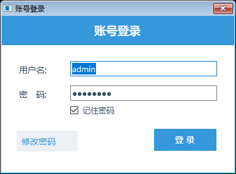 | 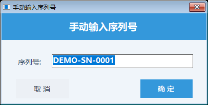 |
| **扫码枪异常提醒（可今日静音）** | **开发者模式（通讯验证 + 账号管理）** |
| 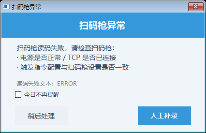 | 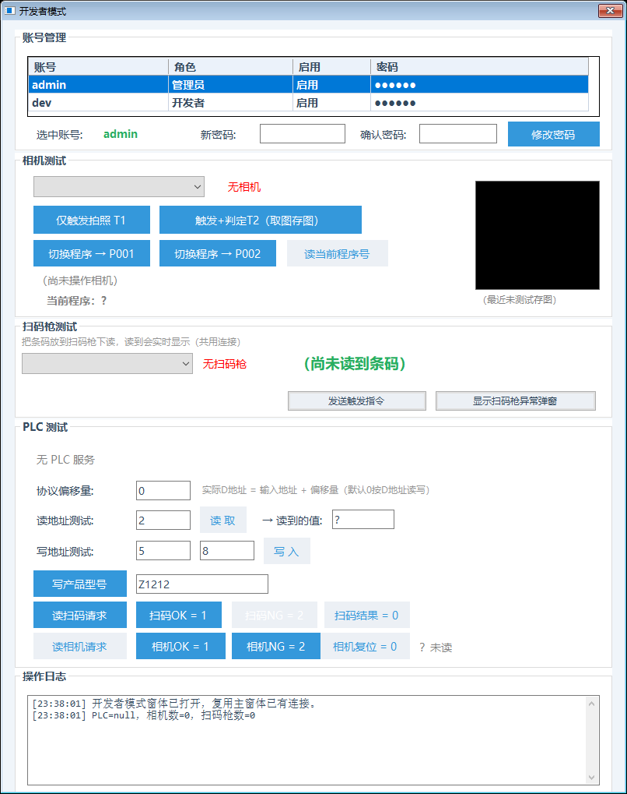 |
| **产品型号↔PLC 序号配置** | |
| 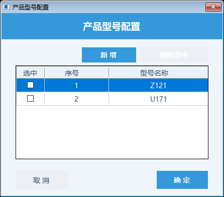 | |

## 快速开始

```powershell
# ① 构建（产物 IrisVision\bin\Debug\IrisVision.exe，启动即用）
& "D:\Program Files\Microsoft Visual Studio\18\Enterprise\MSBuild\Current\Bin\MSBuild.exe" `
  IrisVision/IrisVision.csproj /p:Configuration=Debug /p:Platform=AnyCPU /t:Build /nologo /v:m /m

# ② 自动化验证（构建 → 612 条回归用例 → 80 条 UI 交互 → 两轮进程冒烟，一条命令全绿）
powershell -ExecutionPolicy Bypass -File ".opencode\skills\irisvision-test\scripts\run-all.ps1"

# ③ 桌面快捷方式（名"光阑视界 IrisVision"，图标取 exe 内嵌）
powershell -ExecutionPolicy Bypass -File ".\IrisVision\tools\Create-DesktopShortcut.ps1"

# ④ 现场部署版（代码混淆防反编译，一键出 zip）
& ".\IrisVision\build-obfuscated.ps1"
```

- 首次启动自动生成 `Config/appconfig.json` 默认配置（按现场两台相机 + 一台 TCP 扫码枪兜底），无需手工初始化。
- **一键激活**：现场工控机双击 `IrisVision/tools/auto_activate.bat` 即永久激活；
  程序内主界面【选项】→【软件授权】也可人工激活。未激活只置灰【系统设置】，**不拦生产**。

## 30 秒看懂一轮生产

```
PLC 写 40001=1（扫码请求）
   ▼  收到请求即清空窗口图 + 标题栏计数清零——扫码=新检测件到位
序列号框跳出条码（没扫到就点【人工补录】手输，或扫码枪异常弹窗提醒）
   ▼  SN 到位，PLC 写 40002/40003=点位号（相机拍照请求）
按"型号 + 点位"查程序表 → 发 PW,nnn 切相机程序 → 发 T2 拍照 + 读 OK/NG
   ▼  判定一出结果立刻写回 PLC（40005/40006=1 OK / 2 NG / 3 点位禁用跳过），PLC 不等取图
并行异步：相机 FTP 推图 → 上位机取最新 jpeg+iv4p → 归档 + 删源 → 窗口矩阵显示
   ▼  等 PLC 复位请求 → 上位机复位结果 → 进入下一件（下一件，图片计数自动清零重来）
```

三拍握手（PLC 主站 ↔ 上位机从站，一进一出对账，防残值误当新结果）：

```
 PLC（主站，汇川）                     上位机（从站，本程序 502 端口）
     │ ① 写请求 ≠ 0                        │
     ├─ 40001 扫码 / 40002/40003 相机 ────→ ├ 读到请求，开工
     │                                      │ 扫码 / 切程序 / 拍照 / 判定
     │ ② 读结果                             │ ④ 复位结果 = 0
     ◀── 40004 扫码 / 40005/40006 相机 ─────┤
     │    （1=OK  2=NG  3=点位禁用跳过）      │
     │ ③ 读到结果后复位请求 = 0              │
     ├──────────────────────────────────→  │ 看到请求清零 → 复位结果 → 下一拍
```

混进 NG 长这样——第 4、5 格红徽标，标题栏 NG: 2，操作员照着红格里那张图处置：


## 软件架构

工程按"界面 → 业务编排 → 通讯 → 存储"四层划分，层层单向依赖：

```
┌───────────────────────────────────────────────────────────────┐
│ 界面层    Views/ Controls/                                     │
│   MainForm                主窗体：标题栏 + 窗口矩阵 + 事件接线     │
│   SettingsForm            系统设置（管理员）                     │
│   WindowPointForm         窗口↔点位 + 点位→相机程序 可视化配置     │
│   DirTreeEditForm         存图目录结构可视化配置                 │
│   ModelIndexEditForm      型号↔PLC 序号配置                     │
│   LoginForm               账号登录 + 改密码                     │
│   DeveloperModeForm       开发者模式（通讯验证 + 账号管理）        │
│   CameraDisplayControl    单窗口控件：显示图 + OK/NG 徽标          │
├───────────────────────────────────────────────────────────────┤
│ 业务编排  Services/                                             │
│   ProductionCoordinator   生产流程大脑（三通道状态机，核心）        │
│   ConnectionMonitor       后台心跳 + 断线自动重连 + 边沿日志        │
├───────────────────────────────────────────────────────────────┤
│ 通讯    Services/                                               │
│   PlcService              Modbus TCP 从站（请求/结果握手）         │
│   KeyenceIV4Camera        相机 TCP 触发 + 读判定 + FTP 取图         │
│   ScannerTcp/SerialService 扫码枪 TCP/串口，连上发 LON + 收码       │
│   MesService              扫码 SN 后台上传 MES（可选，默认开）       │
├───────────────────────────────────────────────────────────────┤
│ 存储    Utils/ Models/                                          │
│   ConfigStore             appconfig.json 读写 + 旧配置自动补齐     │
│   ImageStore              监听 FTP 新图、归档双格式、定期清理过期    │
│   SecurityUtil            密码 SHA-256 哈希 + 记住密码 DPAPI        │
│   SoftwareActivation      软件授权（MD5 授权码，跟机器）            │
│   AppConfig               全部可配置项模型                        │
└───────────────────────────────────────────────────────────────┘
```

通讯层坚持一条铁律（曾为此冻过整窗界面）：**UI 线程不做网络 IO**——轮询/连接/读写 PLC 与相机
一律后台线程 + 强制超时 + 完成后回 UI 刷新，拨了不可达的 IP 界面也不卡。

## 现场设备对表

生产现场的接线关系（默认值，都可在系统设置里改）：

```
                         生产现场（19.87.6.x 网段）
   汇川 PLC ──────Modbus TCP──▶ 上位机 [监听 0.0.0.0:502，从站]
                                     ▲   ▲        │
       上位机连相机/枪（主动）──────────┤   │
                                     │   │ 相机拍照后把图 FTP 推到上位机目录
   上相机 19.87.6.213 ◀──TCP 触发────┤   │  ─────────► D:\IV存图\2
   下相机 19.87.6.212 ◀──TCP 触发────┤   │  ─────────► D:\IV存图\1
   扫码枪 19.87.6.100:9004 ◀─TCP─────┘   （上位机监听落盘目录取图，无需装 FTP 服务器）
```

| 设备 | 地址 | 关键点 |
| --- | --- | --- |
| 汇川 PLC（主站） | 由 PLC 主动连上位机 502 | 上位机只监听，不主动连 PLC |
| 上相机（基恩士 IV4） | `19.87.6.213:8500` | 真编号 **cameraId=2**，拍照推图到 `D:\IV存图\2`；PLC 通道 40002/40005 |
| 下相机（基恩士 IV4） | `19.87.6.212:8500` | 真编号 **cameraId=1**，拍照推图到 `D:\IV存图\1`；PLC 通道 40003/40006 |
| 扫码枪（基恩士 SR） | `19.87.6.100:9004` | TCP 无协议，连上后发 `LON` 开始读码；串口枪可选（默认 COM3/115200/1/None） |

⚠️ 上/下相机的 **IP 与 FTP 目录是"安装位置相反配对"**：上相机（装在上面那台）真编号是 2、
推图到 `\2`。IP/编号/目录在 `CameraConfig.DefaultCameras()` 与 `appconfig.json` 的 `cameras` 段
两处唯一维护，改动只动这两处。

## 型号与窗口矩阵

窗口总数、铺排、每台相机"点位→程序号"表全部**按产品型号走**（默认 U171、Z121，可加新型号）：

| 型号 | 上相机点位 | 下相机点位 | 自适应铺排 |
| --- | --- | --- | --- |
| U171（默认型号） | 1~17 | 1~4 | 3×7=21 格（列最多 7、行列和最小优先） |
| Z121 | 1~18 | 1~3 | 3×7=21 格（同上） |

- **切换型号**：主界面标题栏型号下拉直切——写盘 + 窗口矩阵按新型号点位表重排 + 立即下发 PLC
  （40007 序号 + 40008~40012 型号 ASCII），设备连接一路复用不断开；**换型不用重启**。
- **窗口↔点位映射**：默认"前上相机后下相机"铺排；在【窗口/点位配置…】里可**编辑点位 / 交换位置 /
  恢复默认**，结果按型号存 `display.windowPointMaps`；被禁用的点位跟着窗口走（交换时禁用标志一起搬）。
- **存图点位 = 相机点位号**（不是窗口序号）：上下相机点位号各自从 1 起会重复，靠存图目录里的
  `{相机}` 层隔开。

## 可配置项

全部参数集中在 `Config/appconfig.json`（首次启动自动按默认值生成，小驼峰/kebab 命名）：

```
appconfig.json 顶层结构
├── productModel      当前运营型号（默认 "U171"）
├── productModels     全部型号候选（默认 ["U171","Z121"]）
├── language          界面语言（默认 "zh-CN"，可选 "en-US"）
├── theme             界面主题（默认 "Light"，可选 "Dark" 深色）
├── cameras[]         相机表（每台：IP/端口/编号/FTP 目录/PLC 通道/点位程序表）
├── plc{}             从站监听 + 寄存器地址 + 型号→PLC 序号映射
├── display{}         显示矩阵行列/自适应开关/OK NG 颜色与显隐开关
├── image{}           存图根目录/目录层级/保留天数/时间戳开关
├── scanners[]        扫码枪表（TCP 与串口各自独立成行）
├── sn{}              扫码 SN 去向（二选一：Mes 默认 / Plc，纯配置变量无界面）
└── security{}        管理员 + 开发者账号
```

更换现场配置优先走"系统设置"界面（保存即热生效，改配置免重启），不手改 json。

### 相机（cameras[]）

`cameras` 是数组，每台相机一条。一台相机 = 一个 FTP 目录，所有点位图混放；拍照由
**PLC 请求点位号 → 按"型号+点位"查程序表 → PW 切程序 → T2 拍照** 完成。上位机取图
**事件路径优先**（相机推图触发文件事件的路径直接用，外源高频推图不会串到别的枪），
配对失败回退扫目录取"修改时间最新"的一对（文件名不保证固定编号），归档后**删除 FTP 源文件**（中转即删）。

| 字段 | 默认（上相机 \| 下相机） | 白话说明 |
| --- | --- | --- |
| `name` | 上相机 \| 下相机 | 显示名，也当 `{相机}` 目录层名 |
| `cameraId` | 2 \| 1 | 相机真编号 = 存图目录号，窗口↔点位反查的关联键 |
| `ipAddress` | 19.87.6.213 \| 19.87.6.212 | TCP 触发 IP |
| `commandPort` | 8500 | 触发指令端口 |
| `ftpUploadDir` | D:\IV存图\2 \| D:\IV存图\1 | 相机 FTP 推图的落盘目录，上位机监听它取图 |
| `plcRequestAddress` | 2 \| 3 | 该相机拍照请求寄存器（协议号 = 值 + 40000，即 40002/40003） |
| `plcResultAddress` | 5 \| 6 | 结果寄存器（协议 40005/40006）；**0 = 未配置通道、不参与轮询** |
| `triggerCommand` | T1 | 仅触发拍照，不读判定 |
| `triggerAndReadCommand` | T2 | 触发 + 读判定（主用） |
| `readResultCommand` | RT | 单独读判定值 |
| `outputFormat` | 空 | `OF,nn` 输出格式，恰好 2 位数字，配错会让该相机触发失败 |
| `imageWaitMs` | 10000 | 发完 T2 后等 FTP 图的最长时间 |
| `timeoutMs` / `responseTimeoutMs` | 3000 / 5000 | 指令收发超时 |
| `stationPrograms` / `modelStationPrograms` | 见下 | 点位→相机程序号映射表 |

**点位→程序号映射（每种产品型号一张表）**：两台相机分工拍各自动点位，且各相机程序库互相独立、
同一台相机在不同型号下映射也不同，所以按 **相机 + 型号** 分表：

```
modelStationPrograms:
  [{ modelName: "U171", programs: [{ stationNo: 1, programNo: 0 }, …] },   ← 上/下相机各一张
   { modelName: "Z121", programs: [{ stationNo: 1, programNo: 13 }, …] }]
```

触发前按本轮点位查表：命中先发 `PW,nnn` 切到该程序再 `T2`（程序号 0~127 合法；
相邻点位同程序会自动跳过重发）；**未命中不切**，保持相机当前程序。配置入口在【窗口/点位配置…】。

### PLC 通讯（plc{}）

上位机是 **Modbus TCP 从站**，监听本机端口等 PLC 主站连入。寄存器表（配置里填 = **DataStore 索引**，
协议号 = 索引 + 40000，如协议 40002 就填 2）：

| 寄存器 | 方向 | 含义 | 取值 |
| --- | --- | --- | --- |
| 40001 | PLC→上位机 | 扫码请求 | 1=请求扫码、0=无 |
| 40002 / 40003 | PLC→上位机 | 上/下相机拍照请求 | 1~255 = 点位号 |
| 40004 | 上位机→PLC | 扫码结果 | 0=复位、1=OK、2=NG（PLC 拿到 2 死等人工补录，补录后上位机改写成 1） |
| 40005 / 40006 | 上位机→PLC | 上/下相机结果 | 1=OK、2=NG、**3=点位禁用跳过** |
| 40007 | 上位机→PLC | 型号序号 | 查 `plc.modelIndexes`，默认 Z121=1、U171=2 |
| 40008~40012 | 上位机→PLC | 型号 ASCII 字符串 | 每寄存器 2 字符、高字节在前、最多 10 字符 |
| 40013~40024 | 上位机→PLC | 扫码 SN 序列号 | ASCII 编码同型号字符串（24 字符）；扫码 OK/人工补录=本件 SN，失败/超时/上电=全 0；PLC 在读到 40004=1 后读取。写不写本区受 `sn.target` 控制（Mes 目标时不写，见下节） |

关键字段：`ipAddress`（监听 IP，`0.0.0.0`=所有网卡）、`port`（502）、`unitId`（1，需与 PLC 主站一致）、
`scanRequestAddress`/`scanResultAddress`（默认 1/4）、`productModelIndexAddress`（7）/
`productModelAddress`（8）/`productModelLen`（5）、`modelIndexes`（型号→序号映射）、
`scanSerialNumberAddress`（13）/`scanSerialNumberLen`（12 寄存器 = 24 字符）。

几个重要的行为约定：

- **上电初始化复位**：从站一建站成功，先把 40004~40006 结果寄存器 + SN 区全写 0，防断电重启残留旧值被当新结果。
- **PLC 写请求后必须保持该值**，直到读到对应结果≠0 才清零；"写入请求后立刻清零"（脉冲式请求）会碰运气丢失触发点位。
- **相机结果"判定即写"**：判定一出马上写 40005/40006，**不等** FTP 取图归档；图缺失只影响显示和存图，判定不回退。
- **通道释放闸门**：相机通道等"PLC 已复位请求 **且** 拍照任务完全结束"才释放，防止下一拍并发取图混图。

### SN 去向（sn{}，二选一，默认传 MES）

扫码 SN 的去向由配置变量二选一（**设置页无界面入口**，手改 `Config\appconfig.json` 后重启生效）：

| 字段 | 默认 | 白话说明 |
| --- | --- | --- |
| `target` | `Mes` | `Mes`=SN 不写 PLC、后台 HTTP POST 给 MES（**默认**）；`Plc`=写 PLC SN 寄存器区（40013 起，既有流程）。非法值自动回落 `Mes` |
| `mesUrl` | 空 | MES 接收 SN 的完整 URL（http/https），仅 `Mes` 时生效；留空时 SN 不上传并日志 WARN（每进程一次） |
| `mesTimeoutMs` | 3000 | MES 上传超时。上传走后台线程，**不占用 PLC 握手节拍** |

- **上报内容**：HTTP POST JSON `{"sn":"…","model":"…","time":"…"}`（通用占位格式，客户 MES
  协议定稿后只需按 `docs/MES对接说明.md` §5 调整报文，配置不变）；成功/失败只记日志不重试
  （MES 是对账数据，PLC 流程不依赖它）。
- **握手不受影响**：无论 `target` 配什么，40004 结果 1/2 与人工补录流程完全不变；
  `Mes`（默认）时 40013~ SN 区保持全 0。

### 界面语言与主题（language / theme）

| 字段 | 默认 | 说明 |
| --- | --- | --- |
| `language` | `zh-CN` | `zh-CN`=中文 / `en-US`=English。主界面标题栏【选项】下拉菜单切换，**点击即切即存**（热切换免重启）；仅界面文字翻译，日志保持中文 |
| `theme` | `Light` | `Light`=浅色 / `Dark`=深色。同在【选项】下拉菜单，全界面立即换肤免重启；OK 绿/NG 红/PLC 灯等语义色两主题不变 |

### 显示窗口（display{}）

窗口数量默认"**自适应**"铺排（勾选后行列输入框置灰，按当前型号点位表计算；不勾则手填行×列、
自动补行，放不下的多出格 = 空窗口）。自适应规则：列最多 7、取"行列和最小、并列列多者优先"
（21 点位 → 3×7）。U171/Z121 都是 21 点位 → 正好 3×7 占满无空窗。

| 开关字段 | 默认 | 效果 |
| --- | --- | --- |
| `autoFit` | true | 行列是否自动铺排 |
| `rows` / `columns` | 4 / 7 | 非自适应下的手填行列（用时才生效） |
| `okColorName` / `ngColorName` | Green / Red | **OK=绿、NG=红**（现场习惯，可改；配错名回默认色不隐身） |
| `windowOkNgVisible` | true | 窗口右下角 OK/NG 徽标——开着就显示，未判定默认绿 OK、拿到判定按结果变色 |
| `windowIndexVisible` | true | 窗口左上角编号 |
| `windowToolTipVisible` | true | 悬停"双击放大/还原"气泡 |
| `titleOkNgHighlight` | true | 标题栏 OK/NG 计数用实心色块高亮 |
| `showProductModel` / `showSerialNumber` / `showTotalCount` / `showOkCount` / `showNgCount` | true | 标题栏各项显隐 |
| `showSettingsButton` | true | 标题栏"系统设置"按钮（生产现场可关防误改） |

### 图像归档（image{}）

相机拍照 = jpeg + iv4p 两个文件（iv4p 是基恩士私有复盘格式，原样归档）。取到最新一对就归档：
**源文件名 + "_" + 时间戳**（如 `0084.jpeg → 0084_20260814_164022_461.jpeg`，防重复覆盖），
随后删掉 FTP 源文件。

```
E:\Images\                        ← saveRootDir（存图根目录）
└── 2026.08.20\                   ← {年月日}（一个整体目录名，点分隔；不是年/月/日三层）
    └── SN-0001\                  ← {SN}
        ├── 上相机\               ← {相机}（把两台相机隔开，防点位号重复互相覆盖）
        │   └── OK\               ← {OKNG}（按判定分到 OK/NG 两个并列目录）
        │       └── 0084_20260814_164022_461.jpeg  +  同名 .iv4p
        └── 下相机\
            └── NG\
```

- `subDirs`：目录层级列表，**每级只能是一层名字/规则**（`{年月日}`/`{SN}`/`{相机}`/`{OKNG}`）；
  把整条路径粘成一级的老坏配置，加载时自动拆层修复。
- `keepDays`：存图保留天数（默认 30，**0 = 不自动清理**）；后台每天清一次过期目录，只动保存根目录
  过期目录，**绝不动相机 FTP 取图目录**；根目录误配成盘符根（如 `E:\`）时自动放弃防误删整盘。
- `fileTimestampSuffix`：归档文件名是否带时间戳后缀（默认 true）。
- FTP 取图目录由**相机侧配置推图**（基恩士工程师在 IV Navigator 里配），上位机只监听落盘目录，
  **不用装任何 FTP 服务器**；图不到先查相机侧推图配置。

### 扫码枪（scanners[]）

支持多台扫码枪，**TCP**（默认，基恩士 SR TCP/IP 无协议）与**串口**两种，设置页两张表分开配。
任何一台扫到码都更新当前序列号；漏读/没枪时点标题栏【人工补录】手动输入。

| 字段（TCP 行） | 默认 | 说明 |
| --- | --- | --- |
| `enabled` | true | 是否启用 |
| `ipAddress` / `port` | 19.87.6.100 / 9004 | TCP 地址 |
| `triggerCommand` | LON | 连上/重连后自动发一条该指令才开始读码，发时自动补 `\r\n`；留空=不发送（枪设成上电自动读码） |
| `ignoreScanTexts` | ERROR,ERR,NG,NOREAD | 读码失败文本过滤名单：扫码枪读码失败会把错误字符串当"条码"推送，命中名单不当序列号处理，并**自动重发 LON 重试最多 3 次（间隔 1.5s）**；重试耗尽才把扫码结果写 2 通知 PLC（PLC 死等人工补录，补录后覆盖成 1）。瞬时读码失败可自愈。逗号分隔、忽略大小写，`*` 结尾按前缀匹配不误伤同前缀真码。留空=不过滤 |

| 字段（串口行） | 默认 | 说明 |
| --- | --- | --- |
| `portName` / `baudRate` | COM3 / 115200 | 串口号 / 波特率 |
| `stopBits` | "1" | 停止位，存字符串 `"1"`/`"15"`/`"2"` |
| `parity` | None | 校验位，存枚举名 `None/Odd/Even/Mark/Space` |
| `ignoreScanTexts` | ERROR,ERR,NG,NOREAD | 同 TCP 行的过滤名单 |

`mode` 缺省一律按 `"Tcp"`（现场就是 TCP 枪）；`scanners` 段为空时启动自动补一台启用 TCP 枪
（19.87.6.100:9004/LON）——**排查"网络通但程序不连枪"先看 `scanners` 是否为空**。

### 账号与安全（security{}）

| 字段 | 默认 | 说明 |
| --- | --- | --- |
| `adminEnabled` | true | 点"系统设置"是否要登录（生产建议开，防误改配置） |
| `adminUser` / `adminPasswordHash` | admin / 初始密码由交付人当面提供 | 管理员；密码只存 **SHA-256 哈希、不存明文** |
| `devEnabled` / `devUser` / `devPasswordHash` | true / dev / 由交付人当面提供 | 开发者，登录进开发者模式窗体（通讯验证 + 账号管理） |
| 记住密码 | — | 勾选后用 Windows DPAPI 加密存 `%LOCALAPPDATA%\IrisVision\`（绑定本机用户，拷走无效）；管理员/开发者记录**互斥**，登录任一方会清掉另一方 |

管理员密码在**登录对话框**里改（验证原密码 → 新密码两次一致且 ≥6 位 → 保存）；
开发者还可在开发者模式窗体对任意账号**重置密码**。初始 starter 密码不写进任何公开文档，由交付人当面给。

### 软件授权（跟机器一号一码）

- **入口**：主界面标题栏【选项】→【软件授权】（人人可开，无需登录）。显示设备 ID/设备码/激活状态
  → 把设备码报给厂商换激活码 → 粘进激活码框点【激活】。
- **一键激活**：双击 `IrisVision/tools/auto_activate.bat`（`-Mode trial` 试用 30 天、`-DryRun` 只算码不写盘）。
- **语义**：无启动闸、不拦生产。新设备/过期每小时提醒一次，只置灰【系统设置】按钮（PLC 轮询/
  相机/扫码照跑）；激活成功关闭授权窗即自动解灰。授权文件 `MainSetting.ini` 跟机器走（git 不入库）。

## 发布（代码混淆，一键出部署包）

现场部署用**混淆版**，防反编译拿到类名/方法名/设备 IP/寄存器号/相机指令：

```powershell
& ".\IrisVision\build-obfuscated.ps1"
```

- 流程：Release 构建 → Obfuscar 混淆 → 补第三方 dll + config → 启动保活冒烟 → **自动打包上传 zip**
  （版本号取最近 git tag）。
- 产物：上传包 `IrisVision\bin\IrisVision_{版本号}_obfuscated.zip`（内含 exe + 第三方 dll + config +
  Mapping.txt，已排除运行时 Logs）**直接解压部署即可**；混淆目录 `bin\Obfuscated\` 整目录拷现场亦可。
- 混淆只改名/加密字符串，**不改功能**；配置模型 `Models*` 命名空间跳过（字段名 = appconfig.json
  键名），保证现场旧配置可无缝升级。
- 混淆版 PDB 失配无法断点，排查问题请用 Debug 版 + `Logs\` 按天日志。

## 目录结构

```
IrisVision/                    ← 工程根
├── Views/                     界面窗体（MainForm / SettingsForm / LoginForm /
│                              DeveloperModeForm / WindowPointForm / DirTreeEditForm …）
│                              ※ 静态布局在 *.Designer.cs 里可视化维护；动态部分（窗口矩阵、
│                                 状态灯）在业务文件里运行时生成
├── Controls/                  自绘控件（CameraDisplayControl 相机窗 + OK/NG 徽标等）
├── Services/                  通讯与业务编排（ProductionCoordinator / PlcService /
│                              KeyenceIV4Camera / ImageStore / ScannerService(s) /
│                              MesService / ConnectionMonitor / SoftwareActivation）
├── Models/                    配置模型（AppConfig 全量配置 / WindowData 单轮数据）
├── Utils/                     ConfigStore（JSON 读写）/ SecurityUtil / LogHelper（按天日志）
│                              / I18n 双语 / AppTheme 深浅主题 / AppIcon
├── libs/                      本地第三方 DLL（NModbus / Newtonsoft.Json），离线可编译
├── Resources/                 app.ico（exe 内嵌图标，7 层多尺寸）
├── tools/                     内部工具（Obfuscar 混淆器 / Create-DesktopShortcut.ps1 /
│                              auto_activate 激活三件套 / DocShot 拍图 harness）
├── Config/                    运行时配置 appconfig.json（不入库，首次启动自动生成）
└── bin/                       构建产物（不入库）
docs/                          文档中心（手册 + 图像，见下）
```

## 文档中心

| 文档 | 用途 |
| --- | --- |
| `docs/IrisVision.md` | **主文档**：用户操作手册、系统总览与设备清单、扫码枪/相机/PLC 通讯详情与寄存器定义、计数结果流转、IP 参数速查、版本演进 |
| `docs/光阑视界操作员手册.md`(+pdf) | **现场操作员版培训手册**：开机、看界面、生产流程、报警处置、点检与禁忌，大白话、每步配图 |
| `docs/光阑视界客户技术手册.md`(+pdf) | **客户技术工艺版**：系统组成、账号权限、换型、点位程序配置、存图、MES 联调自助闭环、排障 |
| `docs/光阑视界内部手册.md`(+pdf) | **内部版**：权限矩阵（含开发者账号）、账号全流程、工艺知识、技术实现篇、交付清单 |
| `docs/上位机PLC通信接口定义文档.md` | PLC 侧对接视角的通讯接口定义 |
| `docs/MES对接说明.md` | **MES 对接指南**：扫码 SN 传 MES 的配置方法、当前报文格式、协议定稿后代码修改位置、调试验证方法 |
| `docs/上位机通讯封装范式.md` | 通讯架构技术总结（连接/心跳/重连/UI 解耦范式，跨项目可复用） |

## 给接手的开发者

代码约定速记：

- 文件一律 **UTF-8**；`Config/*.json`、`Logs/`、`bin/`、`obj/`、授权 `MainSetting.ini` 不入库。
- **改动后必须构建验证**，并跑自动化测试（上方快速开始②）：构建 → 612 条回归 → 80 条 UI 交互
  → 两轮冒烟，任一失败先分清"产品 bug"还是"约定变更"，再改。
- 通讯/握手/映射类改动必须同步 `docs/IrisVision.md` 对应章节，并记 `CHANGELOG.md`；
  新界面文本一律走 `I18n.T("中文","English")` 双语、新界面构造末尾接 `AppTheme` 深浅主题。
- 混淆发布前检查 `obfuscar.xml`：**`Models*` 命名空间必须在豁免列表里**（配置字段名依赖属性名），
  否则现场旧配置读不回；新增 `DllImport` 必须显式写 `EntryPoint`。
